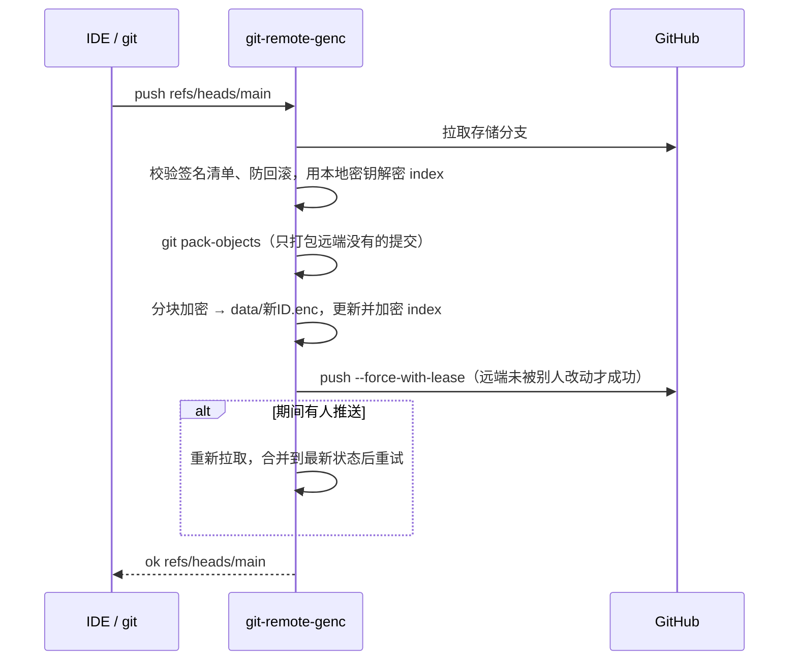
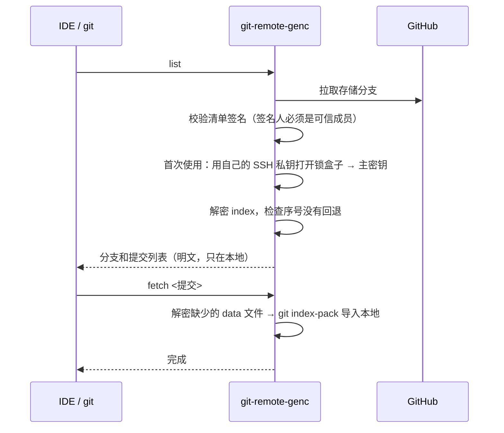

# genc —— Git 仓库透明加密

把源码放在**公开**的 GitHub（或任何 Git 托管服务）上，但服务器上只有密文：代码、文件名、提交信息、作者、分支名都看不到。
本地仍然是一个普通的 git 仓库，VS Code、Visual Studio、JetBrains 和命令行都照常使用，不需要任何插件。

```
 你的电脑（明文，普通 git 仓库）                   GitHub（公开，只有密文）
┌──────────────────────────────┐   push：加密   ┌────────────────────────────┐
│ IDE / git 照常使用             │ ────────────▶ │ data/*.enc   加密的代码数据   │
│ remote = genc::https://...   │ ◀──────────── │ index.enc    加密的索引       │
│ .git/genc/key  本地密钥        │   pull：解密   │ keys/        成员锁盒子+签名  │
└──────────────────────────────┘               └────────────────────────────┘
```

---

## 目录

- [设计目标](#设计目标)
- [功能](#功能)
- [安装](#安装)
- [使用](#使用)
- [架构](#架构)
- [流程](#流程)
- [加密设计](#加密设计)
- [安全说明与局限](#安全说明与局限)
- [测试](#测试)
- [项目结构](#项目结构)

完整设计见 [DESIGN.md](DESIGN.md)。

---

## 设计目标

1. **服务器上只有密文**：代码内容、文件名、目录结构、提交信息、作者、时间、分支名、标签名全部加密。
2. **本地无感**：本地仓库不做任何改动。log、diff、blame、merge、rebase 和 IDE 的全部 git 功能照常工作。
3. **多人协作不传密码**：每人用自己的 SSH 密钥解锁，加人、删人都不需要私下交换密钥。
4. **可以换密钥**：移除成员后自动换密钥。换密钥不改动任何提交（SHA、日期、提交信息都不变）。
5. **防篡改**：即使有人拿到了远端的写权限，也无法伪造内容、回滚，或冒名把自己加进来。
6. **按仓库开关**：只有远程地址带 `genc::` 的仓库会加密，其他仓库完全不受影响。
7. **单文件、跨平台、无依赖**：一个 Go 程序，不需要 GPG、bash、Python。

---

## 功能

| 功能 | 命令 | 管理面板 |
|---|---|---|
| 初始化加密仓库 | `genc init --remote <地址>` | — |
| 克隆 / 拉取 / 推送 | `git clone genc::<地址>`、`git pull`、`git push`（照常使用） | — |
| 添加成员 | `genc add --key <公钥> --name <名字>` / `--github <用户名>` | ✔ |
| 移除成员（自动换密钥） | `genc remove <名字或指纹>` | ✔ |
| 更换密钥 | `genc rotate` | ✔ |
| 更换某成员的公钥 | `genc rekey <名字> --key <新公钥>` | — |
| 备份 / 恢复密钥 | `genc backup` / `genc restore <文件>` | 备份 ✔ |
| 解锁（私钥有口令时） | `genc unlock` / `genc clone <地址>` | ✔ |
| 查看状态、成员、操作记录 | `genc status` / `members` / `log` | ✔ |
| 合并数据文件 | `genc gc` | — |
| 生成密钥、查看自己的公钥 | `genc keygen` / `genc whoami` | — |
| 环境检查 | `genc doctor` | — |
| 管理面板 | `genc ui` | — |
| 明文推送拦截 | 自动安装 pre-push 钩子 | — |

---

## 安装

前提：已安装 Git ≥ 2.31。从源码构建需要 Go ≥ 1.24。

**Windows**（不需要管理员权限）
```powershell
powershell -ExecutionPolicy Bypass -File scripts\install.ps1
```
会安装到 `%LOCALAPPDATA%\genc`，加入用户 PATH，并创建开始菜单快捷方式「genc Manager」。

**macOS / Linux**
```sh
sh scripts/install.sh        # 安装到 ~/.local/bin
```

安装后**重启终端和 IDE**，然后运行：
```sh
genc doctor
```

> 安装的是同一个程序的两个副本：`genc`（管理命令）和 `git-remote-genc`（给 git 调用的 helper）。

---

## 使用

### 1. 准备 SSH 密钥
已经有 `~/.ssh/id_ed25519` 的可以跳过这一步。
```sh
genc keygen          # 生成密钥；加 --passphrase 可以设置口令
genc whoami          # 显示你的公钥和指纹，加入团队时发给管理员
```

### 2. 新建加密仓库
```sh
# 先在 GitHub 上新建一个【空】仓库
cd myproject
genc init --remote https://github.com/xxx/repo.git --name 张三
git push -u origin --all
git push origin --tags
genc backup          # 立即备份密钥！
```
`genc init` 会把 `origin` 设置为 `genc::https://github.com/xxx/repo.git`，并安装拦截明文推送的钩子。

> ⚠️ 远端必须是空仓库。如果代码曾经以明文公开过，那段历史已经泄露，加密无法挽回。

### 3. 日常开发
和平时完全一样：
```sh
git pull
git commit -am "..."
git push
```
IDE 里的提交、推送、拉取、diff、合并也都照常。

### 4. 加入团队

新成员：
```sh
genc whoami          # 把公钥发给任意一位现有成员
```
现有成员：
```sh
genc add --key lisi.pub --name 李四      # 或 genc add --github lisi
# 屏幕会显示李四的指纹：请通过电话或当面与李四核对
```
新成员：
```sh
git clone genc::https://github.com/xxx/repo.git
# 首次连接会显示签名人指纹：请与邀请你的人核对
```
如果私钥有口令，请改用 `genc clone https://github.com/xxx/repo.git`，它会在终端询问口令。解锁一次后就不再需要。

### 5. 移除成员 / 更换密钥
```sh
genc remove 李四     # 移除并自动换密钥
genc rotate          # 定期更换密钥
genc backup          # 换密钥后需要重新备份
```
其他成员下次 `git pull` 时会自动拿到新密钥，不需要任何操作。
移除成员后，请**同时在 GitHub 上收回他的写权限**。

### 6. 管理面板
```sh
genc ui
```
会在浏览器中打开本地页面（只监听 127.0.0.1），可以查看状态、添加或移除成员、更换密钥、备份、解锁和查看操作记录。

### 7. 按项目开关
| 你想要 | 做法 |
|---|---|
| 公开项目 | 照常使用 `https://` 远程地址，不用做任何事 |
| 加密项目 | `genc init --remote <空仓库地址>` |
| 判断项目是否加密 | `git remote -v`，地址带 `genc::` 前缀的就是加密的 |

### 8. 备份恢复
```sh
genc backup                       # 生成恢复文件和恢复口令：请分开离线保存
# 在新机器上：
git init repo && cd repo
git remote add origin genc::https://github.com/xxx/repo.git
genc restore genc-recovery-xxxx.age
git pull origin main
```
所有成员私钥都丢失时，可以用 `genc restore <文件> --takeover` 把新私钥加为成员。

---

## 架构

### 组件
```
┌─────────────────────────────────────────────────────────────────┐
│ genc（同一个可执行文件）                                         │
│                                                                 │
│  git-remote-genc  ── git remote helper 协议（list/fetch/push）   │
│  genc <命令>       ── 成员、密钥、备份、状态管理                     │
│  genc ui          ── 本地管理面板（127.0.0.1 + 一次性令牌）         │
│  genc hook        ── pre-push 钩子：拦截明文推送                    │
│                                                                 │
│  存储层   本地缓存 .git/genc/cache（远端存储分支的镜像）             │
│  信任层   签名清单校验、首次信任、防回滚（.git/genc/state.json）      │
│  加密层   internal/crypt：HKDF + ChaCha20-Poly1305 分块 AEAD       │
│  签名层   internal/sshsig：OpenSSH SSHSIG 格式                     │
│  密钥包裹  age（收件人是成员的 SSH 公钥）                           │
└─────────────────────────────────────────────────────────────────┘
```

### 原理：git remote helper
git 遇到 `genc::<地址>` 时，会自动启动 PATH 里的 `git-remote-genc`，通过标准输入输出与它对话（`capabilities` / `list` / `fetch` / `push`）。git 自带的 https 支持（`git-remote-https`）用的也是这个机制。
因此 IDE 只需要调用 `git.exe`，加密和解密都发生在 helper 里，IDE 完全不知情。

### 两层提交
```
第 1 层：你们的真实提交（只在本地和加密包里）   第 2 层：远端的存储提交（genc 自动生成）
  a1b2c3  张三  2026-03-01  修复登录    加密打包    9f8e7d  genc  "genc update"
  d4e5f6  李四  2026-05-20  新增导出  ─────────▶    └ data/xxx.enc（装着左边的提交）
```
换密钥只替换第 2 层，第 1 层一个字节都不变。

### 远端存储结构（存储分支 `main`）
```
README.md                  固定说明（明文）
keys/manifest.json         成员公钥清单（公开）
keys/manifest.sig          清单签名（由某位成员的 SSH 私钥签署）
keys/<指纹>.key            每个成员一个锁盒子：用他的公钥加密的仓库主密钥
data/<随机ID>-<序号>.enc    加密的 git 数据包（每次推送新增一个，单文件 ≤ 48MB）
index.enc                  加密的索引：分支/标签、数据文件列表、成员名、操作记录
```

### 本地存储
```
<仓库>/.git/genc/key          仓库主密钥（仅当前用户可读；在 .git 内，天然不会被提交）
<仓库>/.git/genc/state.json   可信成员名单、清单版本、索引序号（防回滚）
<仓库>/.git/genc/cache/       远端存储分支的本地镜像
%AppData%\genc 或 ~/.config/genc   genc keygen 生成的私钥
```

---

## 流程

### push


### fetch / pull / clone


### 添加成员
```
新成员：genc whoami → 把公钥发给现有成员
现有成员：genc add → 核对指纹 → 用新成员的公钥加密主密钥（锁盒子）
         → 更新成员清单并用自己的私钥签名 → 推送
新成员：git clone genc::… → 核对签名人指纹 → 用自己的私钥打开锁盒子 → 正常使用
```

### 移除成员 / 更换密钥
```
① 拉取远端最新状态，确保本地拥有全部分支和标签的数据
② 生成新主密钥
③ 把全部数据打成一个包，用新密钥加密；为保留的成员生成新锁盒子；签名新清单
④ 在本地解密校验：所有分支和标签完整
⑤ 生成一个无历史的存储提交，用 --force-with-lease 覆盖远端存储分支
⑥ 其他成员下次 pull：校验签名 → 用自己的私钥打开新锁盒子 → 继续工作
```
不删除仓库，只需要普通推送权限，可以全自动完成。

---

## 加密设计

| 用途 | 算法 |
|---|---|
| 仓库主密钥 | 32 字节随机数 |
| 子密钥派生 | HKDF-SHA256（数据、索引、密钥 ID 分开派生） |
| 每个文件的密钥 | HKDF(子密钥, 随机盐, 用途 + 上下文 + 文件头) |
| 内容加密 | ChaCha20-Poly1305，每 64KB 一块，nonce = 块序号 + 结束标记 |
| 密钥包裹 | age，收件人为 `ssh-ed25519` 或 `ssh-rsa`（≥3072 位）公钥 |
| 清单签名 | OpenSSH SSHSIG（sha512），可以用 `ssh-keygen -Y verify` 校验 |

- **每个文件一把独立的密钥**，不会出现 nonce 重复。
- **每块单独认证，并带结束标记**：篡改、截断、重排、拼接都会被发现。
- **上下文绑定**（仓库 ID、数据包 ID、分片序号）：不能把一个密文文件挪到别的位置使用。

---

## 安全说明与局限

**已防护**
- 远端没有任何明文：每个测试阶段都会扫描远端全部对象来验证。
- 非成员无法读取。被移除的成员在换密钥后无法读取新内容。
- 有写权限但没有密钥的人：篡改、回滚、伪造清单冒名加入、替换锁盒子都会被检测到并拒绝。
- 误把明文推送到普通地址会被 pre-push 钩子拦截。
- 存储提交使用固定身份，不签名，不运行用户的 hook。
- 管理面板只监听 127.0.0.1，需要一次性令牌，并校验 Host 头，不返回 CORS 头。

**局限（请务必了解）**
1. `git push --no-verify` 会跳过拦截钩子。钩子只能防止误操作。
2. 首次 clone 时信任第一次看到的签名人，请与邀请人核对指纹。
3. 移除成员后，必须同时收回他在 GitHub 上的写权限。
4. 清单中公开了成员的 SSH 公钥，拿到某人公钥的人可以判断他是不是成员。名字不会泄露。
5. 不支持 Git LFS：LFS 文件会以明文上传。
6. 外界能看到仓库大小、推送时间和成员数量。
7. **所有成员的私钥都丢失且没有备份，代码将永久无法解密。**
8. 已经泄露的内容收不回：被移除的成员之前下载过的代码、别人 fork 走的旧密文。
9. 使用云端 AI 编程工具时，代码会以明文发给服务商，这不在 genc 的保护范围内。

---

## 测试

```sh
go test ./test/...
```

| 目录 | 内容 |
|---|---|
| `test/unit` | 加密格式（各种长度往返、逐字节篡改、截断、追加、块重排、用途和上下文绑定、错误密钥）；SSH 签名（ed25519/RSA、与 OpenSSH 互通） |
| `test/e2e` | 编译真实程序，用真实 git 模拟多个用户：init、clone/pull/push、非快进拒绝、合并、并发推送、删除分支、标签、加人、移除、换密钥（提交历史不变）、gc、备份恢复、带口令的私钥、管理面板的全部操作和请求防护、各种攻击模拟，每个阶段都做泄露扫描 |

统计真实程序的覆盖率：
```sh
GENC_COVERDIR=/tmp/cov go test ./test/e2e/
go tool covdata percent -i=/tmp/cov
```

---

## 项目结构

```
cmd_main.go        命令行入口与各命令
cmd_helper.go      git remote helper 协议、pre-push 钩子
cmd_store.go       远端存储读写、校验、信任、数据包导入导出
cmd_ops.go         push、成员管理、换密钥、init
cmd_identity.go    SSH 密钥加载、口令、keygen
cmd_ui.go          本地管理面板服务端（页面在 ui.html）
cmd_git.go         调用 git 的封装（隔离环境变量、禁用 hook 和签名）
cmd_util.go        原子写文件、权限、文件锁
internal/crypt     加密文件格式
internal/sshsig    SSH 签名
scripts/           安装脚本
test/              单元测试与端到端测试
DESIGN.md          完整设计文档
```

构建：
```sh
go build -o bin/genc .
cp bin/genc bin/git-remote-genc      # Windows 上是 .exe
```
