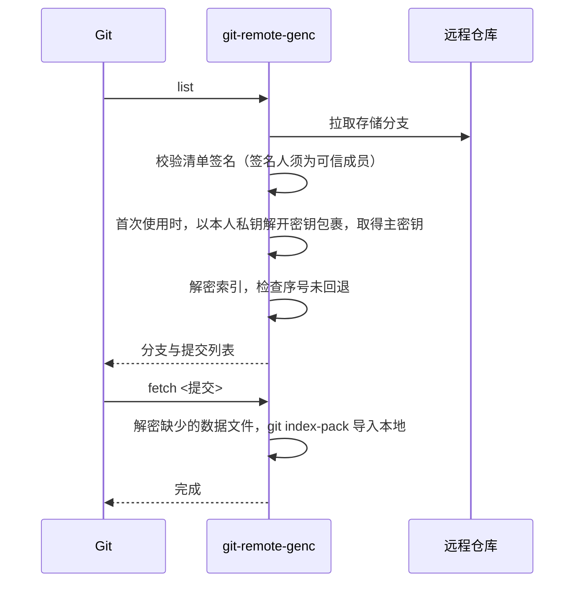

# genc

**Git 仓库端到端加密扩展**

genc 是基于 Git 原生扩展机制实现的加密扩展。它不修改 Git 本身，也不改变本地仓库格式，只是在 Git 与远程托管服务之间增加一层透明的加解密：数据在推送前于本地加密、拉取后于本地解密，远程托管服务仅存储密文。源代码、目录结构、提交元数据（提交信息、作者、时间）及分支与标签名称均不会以明文形式离开本地。

由于扩展完全基于 Git 自身提供的接口，本地仓库始终是标准 Git 仓库，现有工作流、IDE 集成与工具链无需任何改动。实现原理见[工作原理](#工作原理)。

- **端到端加密**：ChaCha20-Poly1305 分块认证加密，密钥仅保存在客户端
- **基于公钥的成员管理**：每位成员使用自己的密钥对解锁，无需共享口令，支持成员增删与密钥轮换。密钥对由 genc 内置生成，不依赖 SSH 或其他外部工具
- **完整性保护**：成员清单经签名校验，可抵御篡改、回滚与冒名替换
- **托管平台无关**：适用于 GitHub、GitLab、Gitea 等任意 Git 托管服务
- **单文件分发**：无运行时依赖，支持 Windows、macOS、Linux

完整设计见 [DESIGN.md](DESIGN.md)。

---

## 目录

- [设计目标](#设计目标)
- [工作原理](#工作原理)
- [功能](#功能)
- [安装](#安装)
- [使用](#使用)
- [架构](#架构)
- [流程](#流程)
- [加密设计](#加密设计)
- [安全模型与已知限制](#安全模型与已知限制)
- [测试](#测试)
- [项目结构](#项目结构)

---

## 设计目标

1. **远程仅存密文**：代码内容、文件名、目录结构、提交信息、作者、时间、分支与标签名称全部加密。
2. **对本地透明**：本地仓库不做任何改动，log、diff、blame、merge、rebase 等操作及 IDE 的 Git 功能不受影响。
3. **无需共享口令**：每位成员以自己的密钥对解锁，加入和移除成员都不需要私下传递密钥。
4. **支持密钥轮换**：移除成员时自动轮换密钥。轮换不改动任何提交，SHA、日期和提交信息保持不变。
5. **可抵御篡改**：即使攻击者获得远程仓库的写权限，也无法伪造内容、回滚状态，或冒名加入成员。
6. **按仓库启用**：只有远程地址使用 `genc::` 前缀的仓库会被加密，其他仓库不受影响。
7. **易于分发**：单一 Go 可执行文件，不依赖 GPG、bash 或 Python。

---

## 工作原理

genc 使用了 Git 自身提供的两个扩展点：**remote helper**（远程传输扩展）和 **hooks**（钩子）。两者都是 Git 的官方机制，Git 本身无需任何修改。

### 1. Remote helper：Git 的远程传输扩展机制

Git 与远程仓库之间的数据传输是可扩展的。Git 自带的 HTTPS 支持就是以这种方式实现的，它对应 Git 安装目录中的 `git-remote-https` 程序。官方文档见 `git help remote-helpers`。

**① 按名称查找扩展程序**

当远程地址形如 `<transport>::<address>` 时，Git 会在 `PATH` 中查找名为 `git-remote-<transport>` 的可执行文件，并把传输工作交给它：

| 远程地址 | Git 调用的程序 | 传入的地址 |
|---|---|---|
| `https://github.com/org/repo.git` | `git-remote-https`（Git 自带） | `https://github.com/org/repo.git` |
| `genc::https://github.com/org/repo.git` | `git-remote-genc`（genc 提供） | `https://github.com/org/repo.git` |

扩展程序只需放在 `PATH` 中即可生效，不需要注册，也不需要修改 Git 配置。

**② 以子进程方式运行**

执行 `git clone`、`git fetch`、`git pull`、`git push` 时，Git 会启动扩展程序：

```
git-remote-genc <远程名> <地址>
```

同时通过环境变量 `GIT_DIR` 告诉它本地仓库的位置。之后双方通过标准输入/输出，以逐行的文本协议通信。

**③ 通信协议**

以下是一次 `git push` 的简化交互过程（`→` 为 Git 发出的命令，`←` 为 genc 的应答）：

```
→ capabilities                      询问扩展支持哪些能力
← option
← fetch
← push
← (空行)

→ list for-push                     询问远程有哪些分支
← 3f2a9c... refs/heads/main         genc 下载并解密索引后，以明文告诉 Git
← @refs/heads/main HEAD
← (空行)

→ push refs/heads/main:refs/heads/main
→ (空行)
← ok refs/heads/main                genc 完成打包、加密、上传后回复结果
← (空行)
```

各命令在 genc 中的处理：

| 命令 | genc 的处理 |
|---|---|
| `list` | 拉取远程存储分支，校验签名清单，解密索引，返回分支与提交列表 |
| `fetch <提交>` | 下载本地缺少的数据文件，解密后用 `git index-pack` 导入本地对象库 |
| `push <源>:<目标>` | 用 `git pack-objects` 打包远程缺少的对象，加密后上传，并更新加密索引 |

Git 只与扩展程序交换**明文**的分支名和对象。加密、解密以及与远程服务器之间的通信全部在扩展程序内部完成，因此 Git 本身并不知道数据经过了加密。

**④ 对 IDE 透明的原因**

```
VS Code / Visual Studio / JetBrains
   └─ 调用 git 可执行文件（push / pull / fetch）
        └─ Git 识别 genc:: 前缀，启动 git-remote-genc
             └─ 加密后与远程服务器通信
```

IDE 只与 `git` 可执行文件交互，扩展程序由 Git 负责调用，因此 IDE 无需任何插件。commit、log、diff、blame、merge 等操作只读写本地仓库，根本不经过扩展程序，性能与普通仓库相同。

### 2. Hooks：防止明文误推送

对于已加密的仓库，genc 会安装 Git 的 `pre-push` 钩子。如果有人把仓库推送到不带 `genc::` 前缀的普通地址，推送会被拒绝，以防明文被误传到服务器。

### 3. 两层提交

```
第 1 层：真实提交（仅存在于本地及加密数据中）     第 2 层：远程存储提交（由 genc 生成）
  a1b2c3  张三  2026-03-01  修复登录    加密打包    9f8e7d  genc  "genc update"
  d4e5f6  李四  2026-05-20  新增导出  ─────────▶    └ data/xxx.enc（包含左侧全部提交）
```

远程仓库中只有由 genc 生成的存储提交。这些提交的作者固定为 `genc`，提交信息固定为 `genc update`，内容全部是密文。轮换密钥时只替换第 2 层，第 1 层不变。

---

## 功能

| 功能 | 命令 | 管理面板 |
|---|---|---|
| 初始化加密仓库 | `genc init --remote <地址>` | — |
| 克隆 / 拉取 / 推送 | `git clone genc::<地址>`、`git pull`、`git push` | — |
| 添加成员 | `genc add --key <公钥文件> --name <名称>` 或 `--github <用户名>` | ✔ |
| 移除成员（自动轮换密钥） | `genc remove <名称或指纹>` | ✔ |
| 轮换密钥 | `genc rotate` | ✔ |
| 替换成员公钥 | `genc rekey <名称> --key <新公钥文件>` | — |
| 备份 / 恢复密钥 | `genc backup` / `genc restore <文件>` | 备份 ✔ |
| 解锁（私钥受口令保护时） | `genc unlock` / `genc clone <地址>` | ✔ |
| 状态、成员、操作日志 | `genc status` / `genc members` / `genc log` | ✔ |
| 合并数据文件 | `genc gc` | — |
| 生成密钥 / 查看本人公钥 | `genc keygen` / `genc whoami` | — |
| 环境检查 | `genc doctor` | — |
| 本地管理面板 | `genc ui` | — |
| 明文推送拦截 | 自动安装 `pre-push` 钩子 | — |

---

## 安装

**环境要求**：Git 2.31 或更高版本。从源码构建需要 Go 1.24 或更高版本。

**Windows**（不需要管理员权限）
```powershell
powershell -ExecutionPolicy Bypass -File scripts\install.ps1
```
程序安装到 `%LOCALAPPDATA%\genc`，并加入用户 `PATH`，同时创建开始菜单快捷方式 “genc Manager”。

**macOS / Linux**
```sh
sh scripts/install.sh        # 安装到 ~/.local/bin
```

安装完成后，重启终端和 IDE 使 `PATH` 生效，然后执行环境检查：
```sh
genc doctor
```

> 安装内容是同一个程序的两个副本：`genc`（管理命令）和 `git-remote-genc`（供 Git 调用的扩展）。

---

## 使用

### 成员密钥对

每位成员在自己的电脑上生成一个密钥对，不需要向任何人或服务器申请：
```sh
genc keygen          # 生成密钥对；加 --passphrase 可为私钥设置口令
genc whoami          # 显示公钥与指纹
```

| | 私钥 | 公钥 |
|---|---|---|
| 位置 | 仅保存在本人电脑（`%AppData%\genc` 或 `~/.config/genc`） | 提供给团队成员 |
| 保密性 | **必须保密** | 可以公开，泄露不影响安全 |
| 用途 | 解锁仓库、签署成员变更 | 供现有成员为其加密仓库主密钥 |

- 密钥对的生成、加密和签名全部在 genc 内部完成，不依赖 SSH 客户端、OpenSSH 或 GPG，各平台行为一致。
- 密钥采用与 OpenSSH 兼容的格式（公钥是以 `ssh-ed25519` 开头的一行文本）。这只是格式约定，genc 不会使用 SSH 协议或调用 SSH 程序。已有 `~/.ssh/id_ed25519` 的成员可以直接复用这把密钥，无需重新生成。
- **持有密钥对并不代表能够访问仓库。** 只有被现有成员登记的公钥才能解锁，见下文"添加成员"。

### 创建加密仓库
先在托管平台上创建一个**空仓库**，然后执行：
```sh
cd myproject
genc init --remote https://github.com/org/repo.git --name 张三
git push -u origin --all
git push origin --tags
genc backup
```
`genc init` 会把 `origin` 设为 `genc::https://github.com/org/repo.git`，并安装明文推送拦截钩子。

> **注意**：远程仓库必须为空。如果代码曾经以明文公开过，那部分历史已经泄露，加密无法补救。

### 日常开发
与普通 Git 仓库完全相同，命令行和 IDE 均可：
```sh
git pull
git commit -am "..."
git push
```

### 添加成员

**加入流程**
```
① 新成员   genc keygen                         生成密钥对
② 新成员   genc whoami                         将公钥发送给任意一位现有成员（公钥可通过任意渠道发送）
③ 现有成员 genc add --key 公钥文件 --name 李四    屏幕显示新成员的指纹，经电话或当面与新成员核对一致后确认
④ 新成员   git clone genc::<仓库地址>            与邀请人核对首次连接时显示的签名人指纹
```
- 第 ③ 步也可以用 `genc add --github <用户名>`，直接读取该用户在 GitHub 上公开的公钥；或在管理面板中点击"添加成员"。
- 如果新成员的私钥受口令保护，第 ④ 步请改用 `genc clone <仓库地址>`，它会在终端提示输入口令。解锁一次后，之后的操作不再需要口令。
- 仓库的第一位成员是执行 `genc init` 的人，之后的成员都由已有成员邀请加入。

**为什么需要核对指纹**
- 第 ③ 步的核对用于防止公钥在传递过程中被调包，例如有人冒充新成员发送自己的公钥。
- 第 ④ 步的核对用于防止新成员连接到被他人伪造的仓库状态。

**为什么外部人员无法自行加入**

仓库是公开的，任何人都可以生成自己的密钥对并尝试克隆，但无法读取内容：
1. 仓库主密钥只会由现有成员，用被邀请者的公钥逐一加密保存（密钥包裹）。没有为其准备的密钥包裹，克隆时会提示"你还不是该仓库的成员"。
2. 自行登记需要同时具备仓库主密钥和现有成员的私钥签名。即使攻击者取得了托管平台上的写权限并写入伪造的成员清单，所有成员的客户端也会因签名不可信而拒绝。端到端测试中包含了这一攻击场景。

需要妥善保护的是**私钥**，以及**备份文件和恢复口令**。私钥一旦泄露，应立即用 `genc remove` 移除该成员（会自动轮换密钥），再让其使用新密钥对重新加入。

### 移除成员与轮换密钥
```sh
genc remove 李四     # 移除成员，并自动轮换密钥
genc rotate          # 定期轮换密钥
genc backup          # 轮换后需要重新备份
```
其他成员下次执行 `git pull` 时会自动获取新密钥，无需任何操作。移除成员后，还应在托管平台上收回该成员的写权限。

### 管理面板
```sh
genc ui
```
在本机浏览器中打开管理页面（仅监听 `127.0.0.1`），可以查看状态、管理成员、轮换密钥、备份、解锁和查看操作日志。

### 按仓库启用

| 需求 | 操作 |
|---|---|
| 公开仓库 | 使用普通远程地址即可，无需任何操作 |
| 加密仓库 | `genc init --remote <空仓库地址>` |
| 判断仓库是否加密 | `git remote -v`，地址带 `genc::` 前缀即为加密仓库 |

### 备份与恢复
```sh
genc backup          # 生成恢复文件和恢复口令，两者应分开离线保存
```
在新环境中恢复：
```sh
git init repo && cd repo
git remote add origin genc::https://github.com/org/repo.git
genc restore genc-recovery-xxxx.age
git pull origin main
```
如果所有成员的私钥都已丢失，可以执行 `genc restore <文件> --takeover`，把新私钥登记为成员。

---

## 架构

### 总览
```
 本地（标准 Git 仓库，明文）                       远程托管服务（仅密文）
┌──────────────────────────────┐   push：加密   ┌────────────────────────────┐
│ IDE / git                    │ ────────────▶ │ data/*.enc   加密数据包      │
│ remote = genc::https://...   │ ◀──────────── │ index.enc    加密索引        │
│ .git/genc/key  仓库主密钥      │   pull：解密   │ keys/        密钥包裹与签名   │
└──────────────────────────────┘               └────────────────────────────┘
```

### 组件
```
┌─────────────────────────────────────────────────────────────────┐
│ genc（单一可执行文件）                                           │
│                                                                 │
│  git-remote-genc  Git remote helper 协议实现（list/fetch/push）  │
│  genc <命令>       成员、密钥、备份与状态管理                        │
│  genc ui          本地管理面板（127.0.0.1 + 一次性令牌）             │
│  genc hook        pre-push 钩子：拦截明文推送                       │
│                                                                 │
│  存储层   远程存储分支的本地镜像 .git/genc/cache                   │
│  信任层   签名清单校验、首次使用信任、防回滚                         │
│  加密层   internal/crypt：HKDF + ChaCha20-Poly1305 分块 AEAD       │
│  签名层   internal/sshsig：OpenSSH SSHSIG 格式                     │
│  密钥包裹  age（收件人为成员公钥）                                  │
└─────────────────────────────────────────────────────────────────┘
```

### 远程存储结构（存储分支 `main`）
```
README.md                  固定说明（明文）
keys/manifest.json         成员公钥清单（公开）
keys/manifest.sig          清单签名（由一位成员的私钥签署）
keys/<指纹>.key            每位成员一份密钥包裹：用该成员公钥加密的仓库主密钥
data/<随机ID>-<序号>.enc    加密的 Git 数据包（每次推送新增一份，单文件不超过 48MB）
index.enc                  加密索引：分支与标签、数据文件列表、成员名称、操作日志
```

### 本地存储
```
<仓库>/.git/genc/key          仓库主密钥（仅当前用户可读；位于 .git 内，不会被提交）
<仓库>/.git/genc/state.json   可信成员清单、清单版本、索引序号（用于防回滚）
<仓库>/.git/genc/cache/       远程存储分支的本地镜像
%AppData%\genc 或 ~/.config/genc   genc keygen 生成的私钥
```

---

## 流程

### 推送


### 拉取与克隆


### 添加成员
```
新成员    genc whoami，提供公钥
现有成员  genc add → 核对指纹 → 用新成员公钥加密主密钥 → 更新并签名成员清单 → 推送
新成员    git clone genc::<地址> → 核对签名人指纹 → 以本人私钥解锁
```

### 移除成员与轮换密钥
```
1. 拉取远程最新状态，确保本地拥有全部分支和标签的数据
2. 生成新的主密钥
3. 用新密钥重新加密全部数据；为保留的成员生成新的密钥包裹；签名新清单
4. 在本地解密校验，确认全部分支和标签完整
5. 生成无历史的存储提交，以 --force-with-lease 覆盖远程存储分支
6. 其他成员下次拉取时校验签名，以本人私钥解开新的密钥包裹
```
整个过程不删除仓库，只需要普通推送权限，可以全自动完成。

---

## 加密设计

| 用途 | 算法 |
|---|---|
| 仓库主密钥 | 32 字节随机数 |
| 子密钥派生 | HKDF-SHA256（数据、索引、密钥 ID 分别派生） |
| 文件密钥 | HKDF(子密钥, 随机盐, 用途‖上下文‖文件头) |
| 内容加密 | ChaCha20-Poly1305，64 KiB 分块，nonce = 块序号‖结束标记 |
| 密钥包裹 | age，收件人为成员公钥（Ed25519，或不少于 3072 位的 RSA；OpenSSH 兼容格式） |
| 清单签名 | SSHSIG 签名格式（SHA-512），可用通用工具 `ssh-keygen -Y verify` 独立校验 |

- **每个文件使用独立密钥**，避免 nonce 重复。
- **逐块认证并带结束标记**，可以检测篡改、截断、重排和拼接。
- **上下文绑定**：仓库 ID、数据包 ID、分片序号都参与密钥派生，密文文件不能被挪到其他位置使用。

---

## 安全模型与已知限制

### 防护范围
- 远程不存在任何明文。测试的每个阶段都会扫描远程的全部对象，以验证这一点。
- 非成员无法读取仓库内容。被移除的成员在密钥轮换后无法读取新内容。
- 对于持有远程写权限但没有密钥的攻击者，篡改内容、回滚状态、伪造清单冒名加入、替换密钥包裹均会被检测并拒绝。
- 向普通地址的明文推送会被 `pre-push` 钩子拦截。
- 存储提交使用固定身份，不签名，也不执行用户钩子。
- 管理面板仅监听 `127.0.0.1`，需要一次性令牌，并校验 Host 头，不返回 CORS 头。

### 已知限制
1. `git push --no-verify` 会跳过 `pre-push` 钩子。钩子只能防止误操作，不能作为强制措施。
2. 首次克隆时，信任首次看到的签名人。新成员必须与邀请人核对签名人指纹。
3. 移除成员后，必须同时在托管平台上收回其写权限。
4. 成员清单公开了成员的公钥。持有某人公钥的第三方可以据此判断其是否为成员，但成员名称不会泄露。
5. 不支持 Git LFS：LFS 对象会绕过 genc，以明文上传。
6. 仓库大小、推送时间和成员数量对外可见。
7. 如果所有成员的私钥都已丢失且没有备份，数据将永久无法解密。
8. 已经泄露的数据无法收回，包括被移除成员此前获取的内容，以及第三方此前复制的密文。
9. 使用云端 AI 编程工具时，代码会以明文发送给服务提供方。这不在 genc 的防护范围内。

---

## 测试

```sh
go test ./test/...
```

| 目录 | 内容 |
|---|---|
| `test/unit` | 加密格式：各种长度的往返、逐字节篡改、截断、追加、块重排、用途与上下文绑定、错误密钥；清单签名：Ed25519/RSA，以及与 OpenSSH 工具的互通 |
| `test/e2e` | 构建真实的可执行文件，用真实 Git 模拟多名用户：初始化、克隆/拉取/推送、非快进拒绝、合并、并发推送、删除分支、标签、成员增删、密钥轮换（提交历史不变）、gc、备份恢复、口令保护的私钥、管理面板全部操作及请求防护、攻击模拟；每个阶段都做泄露扫描 |

统计真实可执行文件的覆盖率：
```sh
GENC_COVERDIR=/tmp/cov go test ./test/e2e/
go tool covdata percent -i=/tmp/cov
```

---

## 项目结构

```
cmd_main.go        命令行入口与各命令实现
cmd_helper.go      Git remote helper 协议、pre-push 钩子
cmd_store.go       远程存储读写、校验、信任、数据包导入导出
cmd_ops.go         推送、成员管理、密钥轮换、初始化
cmd_identity.go    成员密钥加载、口令处理、密钥生成
cmd_ui.go          本地管理面板服务端（页面为 ui.html）
cmd_git.go         Git 调用封装（隔离环境变量，禁用钩子与签名）
cmd_util.go        原子写入、文件权限、文件锁
internal/crypt     加密文件格式
internal/sshsig    清单签名（SSHSIG 格式）
scripts/           安装脚本
test/              单元测试与端到端测试
DESIGN.md          完整设计文档
```

构建：
```sh
go build -o bin/genc .
cp bin/genc bin/git-remote-genc      # Windows 下为 .exe
```
