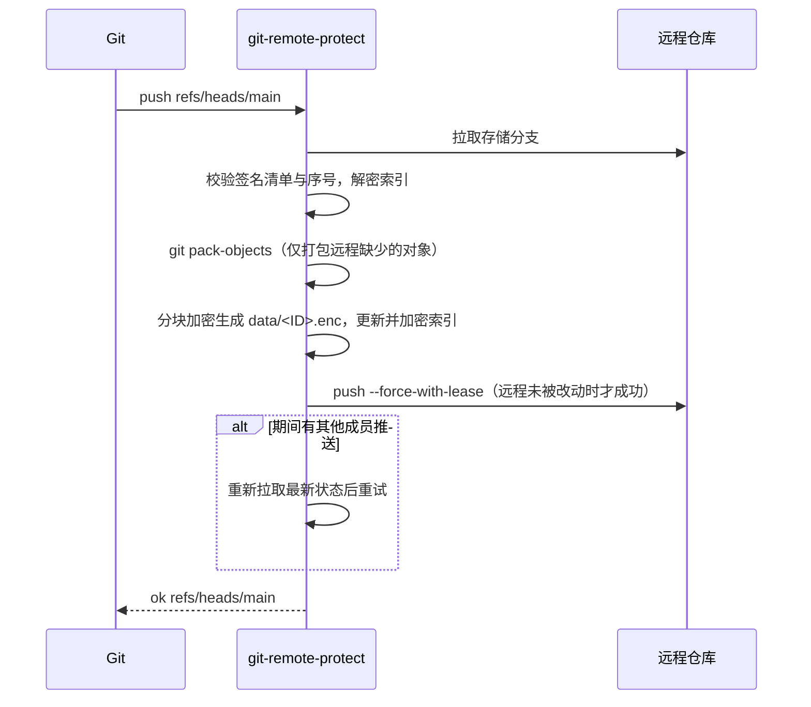
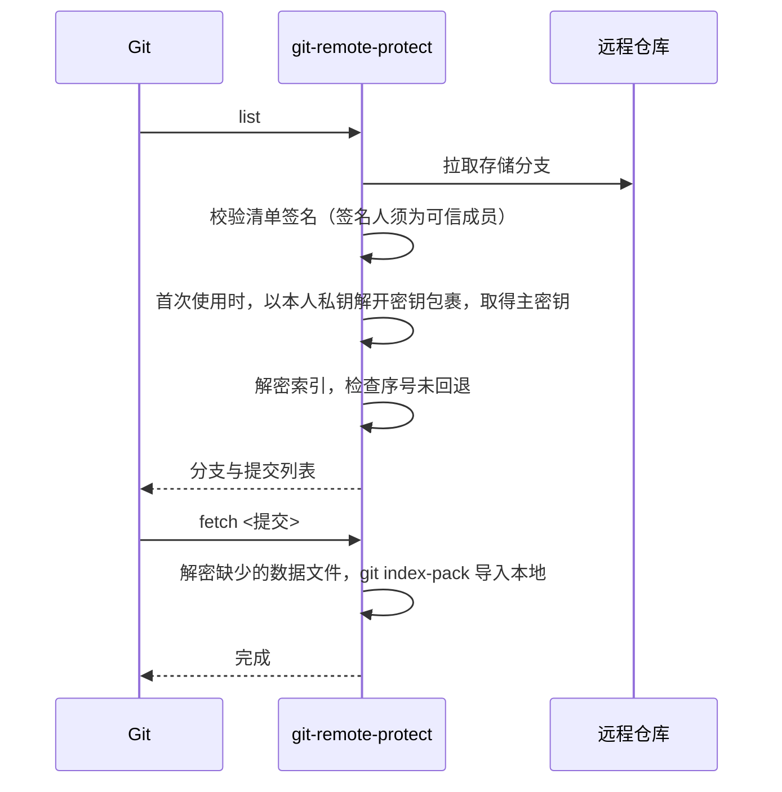

# Git Protect

**Git 仓库端到端加密扩展**

Git Protect 是基于 Git 原生扩展机制实现的加密扩展。它不修改 Git 本身，也不改变本地仓库格式，只是在 Git 与远程托管服务之间增加一层透明的加解密：数据在推送前于本地加密、拉取后于本地解密，远程托管服务仅存储密文。源代码、目录结构、提交元数据（提交信息、作者、时间）及分支与标签名称均不会以明文形式离开本地。

由于扩展完全基于 Git 自身提供的接口，本地仓库始终是标准 Git 仓库，现有工作流、IDE 集成与工具链无需任何改动。

- **端到端加密**：ChaCha20-Poly1305 分块认证加密，密钥仅保存在客户端
- **基于公钥的成员管理**：每位成员使用自己的密钥对解锁，无需共享口令，支持成员增删与密钥轮换。密钥对由 Git Protect 内置生成，不依赖 SSH 或其他外部工具
- **完整性保护**：成员清单经签名校验，可抵御篡改、回滚与冒名替换
- **托管平台无关**：适用于 GitHub、GitLab、Gitea 等任意 Git 托管服务
- **单文件分发**：无运行时依赖，支持 Windows、macOS、Linux

---

## 目录

- [工作原理](#工作原理)
- [快速开始](#快速开始)
- [使用指南](#使用指南)
- [安全说明](#安全说明)
- [架构](#架构)
- [流程](#流程)
- [测试](#测试)
- [项目结构与构建](#项目结构与构建)

完整设计见 [DESIGN.md](DESIGN.md)。

---

## 工作原理

Git 允许通过外部程序扩展远程传输方式。远程地址写成 `protect::<地址>` 时，Git 会自动调用 Git Protect 提供的 `git-remote-protect` 来完成推送和拉取。Git Protect 在这一环节完成加解密：

```
 本地（标准 Git 仓库，明文）                       远程托管服务（仅密文）
┌──────────────────────────────┐   push：加密   ┌────────────────────────────┐
│ IDE / git                    │ ────────────▶ │ data/*.enc   加密数据包      │
│ remote = protect::https://…  │ ◀──────────── │ index.enc    加密索引        │
│ .git/protect/key  仓库主密钥   │   pull：解密   │ keys/        密钥包裹与签名   │
└──────────────────────────────┘               └────────────────────────────┘
```

- commit、log、diff、merge 等操作只涉及本地仓库，与普通 Git 仓库完全相同。
- 每位成员用自己的私钥解开仓库主密钥；没有被登记的人即使拿到仓库也无法读取。
- 远程地址不带 `protect::` 前缀的仓库不受任何影响。

详细原理见[架构](#架构)。

---

## 快速开始

### 1. 安装

环境要求：Git 2.31 或更高版本。

从 [Releases](https://github.com/MyCodeKits/git-protect-extension/releases) 页面下载对应平台的压缩包并解压：

| 平台 | 文件 |
|---|---|
| Windows（64 位） | `git-protect_<版本>_windows_amd64.zip` |
| Windows（ARM） | `git-protect_<版本>_windows_arm64.zip` |
| macOS（Apple 芯片） | `git-protect_<版本>_darwin_arm64.tar.gz` |
| macOS（Intel） | `git-protect_<版本>_darwin_amd64.tar.gz` |
| Linux | `git-protect_<版本>_linux_amd64.tar.gz` / `linux_arm64.tar.gz` |

在解压后的目录中运行安装脚本：

**Windows**（不需要管理员权限）
```powershell
powershell -ExecutionPolicy Bypass -File install.ps1
```

**macOS / Linux**
```sh
sh install.sh
```

> 如需从源码安装，请在仓库根目录执行 `scripts\install.ps1` 或 `sh scripts/install.sh`（需要 Go 1.24 或更高版本）。
> 程序未经代码签名：Windows 可能提示“未知发布者”，选择“仍要运行”即可；macOS 的隔离标记会由安装脚本自动清除。

安装完成后重启终端和 IDE，然后执行环境检查：
```sh
git protect doctor
```

### 2. 生成成员密钥对
```sh
git protect keygen
git protect whoami      # 显示公钥与指纹
```

### 3. 创建加密仓库
先在托管平台上创建一个**空仓库**，然后执行：
```sh
cd myproject
git protect init --remote https://github.com/org/repo.git --name 张三
git push -u origin --all
git protect backup      # 备份仓库密钥
```

### 4. 邀请成员
```sh
# 新成员：将公钥发送给现有成员
git protect whoami

# 现有成员：登记新成员（核对屏幕上显示的指纹）
git protect add --key lisi.pub --name 李四

# 新成员：克隆仓库
git clone protect::https://github.com/org/repo.git
```

### 5. 日常使用
与普通 Git 仓库相同，命令行和 IDE 均可：
```sh
git pull
git commit -am "..."
git push
```

> 所有管理命令既可以写成 `git protect <命令>`，也可以写成 `git-protect <命令>`。查看帮助请使用 `git protect help`。

---

## 使用指南

### 密钥说明

Git Protect 中有两种密钥，职责不同：

| | 成员密钥对 | 仓库主密钥 |
|---|---|---|
| 数量 | 每人一对，所有加密仓库共用 | 每个加密仓库一把 |
| 产生方式 | 成员执行 `git protect keygen` 生成（也可复用已有的 SSH 密钥） | `git protect init` 时自动随机生成（256 位） |
| 保存位置 | 本人电脑：`%AppData%\git-protect` 或 `~/.config/git-protect` | 每位成员本地仓库的 `.git/protect/key`；远程只保存以各成员公钥加密后的副本 |
| 用途 | 证明“我是谁”：解开仓库主密钥、签署成员变更 | 加密和解密仓库内容 |
| 需要手动设置吗 | 只需生成一次 | **不需要**。不存在需要输入或配置的仓库口令 |

各场景下的密钥操作：

| 场景 | 需要做的事 | 密钥如何产生和分发 |
|---|---|---|
| 第一次使用 | `git protect keygen` | 生成本人的成员密钥对（只需一次） |
| 新建加密项目 | `git protect init --remote <空仓库>` | 自动生成仓库主密钥，并用你的公钥加密存入远程 |
| 现有项目改为加密 | 同上，见[在现有项目中使用](#在现有项目中使用) | 同上 |
| 加入已有的加密项目 | 提供公钥给现有成员，然后 `git clone` | 现有成员 `git protect add` 时，用你的公钥加密一份仓库主密钥；克隆时自动用你的私钥解开 |
| 移除成员 / 轮换 | `git protect remove` / `rotate` | 自动生成新的仓库主密钥，只为保留的成员重新加密 |
| 换新电脑 | 复制成员密钥对到新电脑，或生成新密钥对后请现有成员登记 | 克隆时自动解锁 |

仓库主密钥始终是随机生成的，不由人设定，因此不存在弱口令问题。唯一需要人工保管的是**成员私钥**和 `git protect backup` 生成的**备份**。

### 成员密钥对

每位成员在自己的电脑上生成密钥对，不需要向任何人或服务器申请：
```sh
git protect keygen                 # 加 --passphrase 可为私钥设置口令
git protect whoami
```

| | 私钥 | 公钥 |
|---|---|---|
| 位置 | 仅保存在本人电脑（`%AppData%\git-protect` 或 `~/.config/git-protect`） | 提供给团队成员 |
| 保密性 | **必须保密** | 可以公开，泄露不影响安全 |
| 用途 | 解锁仓库、签署成员变更 | 供现有成员为其加密仓库主密钥 |

- 密钥对的生成、加密和签名全部在 Git Protect 内部完成，不依赖 SSH 客户端、OpenSSH 或 GPG，各平台行为一致。
- 密钥采用与 OpenSSH 兼容的格式（公钥是以 `ssh-ed25519` 开头的一行文本）。这只是格式约定，Git Protect 不会使用 SSH 协议或调用 SSH 程序。已有 `~/.ssh/id_ed25519` 的成员可以直接复用，无需重新生成。
- **持有密钥对并不代表能够访问仓库。** 只有被现有成员登记的公钥才能解锁。

### 在现有项目中使用

将已有的项目转为加密存储，提交历史（SHA、作者、日期、提交信息）保持不变。

**项目负责人**
```sh
cd existing-project
git protect keygen                          # 第一次使用时执行
git remote rename origin old                # 保留原来的远程（可选）
git protect init --remote https://github.com/org/new-repo.git --name 张三
git push -u origin --all
git push origin --tags
git protect backup
git remote remove old                       # 确认迁移完成后删除原来的远程
```
- 新的远程仓库必须为空。
- `git protect init` 会把 `origin` 指向新的加密地址。之后向任何普通地址（包括原来的远程）推送都会被拦截。
- 迁移完成后，请删除原来的明文仓库，或将其设为私有。

**团队其他成员**：无需重新克隆，在现有的本地仓库中切换远程地址即可。
```sh
git protect whoami                          # 将公钥发给负责人，由负责人执行 git protect add
git remote set-url origin protect::https://github.com/org/new-repo.git
git fetch origin
git branch --set-upstream-to=origin/main
```
本地已有的提交与远程完全一致，切换后不会重新下载数据。

> **原仓库曾经公开过的情况**：已经公开的历史可能已被他人复制，加密无法收回。如果其中包含密码、令牌等敏感信息，应当立即在对应系统中更换这些凭据。

### 添加成员

**加入流程**
```
① 新成员    git protect keygen                          生成密钥对
② 新成员    git protect whoami                          将公钥发送给任意一位现有成员（公钥可通过任意渠道发送）
③ 现有成员  git protect add --key 公钥文件 --name 李四    屏幕显示指纹，经电话或当面与新成员核对一致后确认
④ 新成员    git clone protect::<仓库地址>                与邀请人核对首次连接时显示的签名人指纹
```
- 第 ③ 步也可以使用 `git protect add --github <用户名>`，直接读取该用户在 GitHub 上公开的公钥；或在管理面板中点击“添加成员”。
- 如果新成员的私钥受口令保护，第 ④ 步请改用 `git protect clone <仓库地址>`，它会在终端提示输入口令。解锁一次后，之后的操作不再需要口令。
- 仓库的第一位成员是执行 `git protect init` 的人，之后的成员均由已有成员邀请加入。

**为什么需要核对指纹**
- 第 ③ 步的核对用于防止公钥在传递过程中被调包，例如有人冒充新成员发送自己的公钥。
- 第 ④ 步的核对用于防止新成员连接到被他人伪造的仓库状态。

**为什么外部人员无法自行加入**

仓库是公开的，任何人都可以生成自己的密钥对并尝试克隆，但无法读取内容：
1. 仓库主密钥只会由现有成员，用被邀请者的公钥逐一加密保存（密钥包裹）。没有为其准备的密钥包裹，克隆时会提示“你还不是该仓库的成员”。
2. 自行登记需要同时具备仓库主密钥和现有成员的私钥签名。即使攻击者取得了托管平台上的写权限并写入伪造的成员清单，所有成员的客户端也会因签名不可信而拒绝。端到端测试中包含了这一攻击场景。

### 移除成员与轮换密钥
```sh
git protect remove 李四      # 移除成员，并自动轮换密钥
git protect rotate           # 定期轮换密钥
git protect backup           # 轮换后需要重新备份
```
- 轮换会用新密钥重新加密全部数据并覆盖远程存储分支，**提交的 SHA、日期、提交信息均保持不变**。
- 其他成员下次执行 `git pull` 时会自动获取新密钥，无需任何操作。
- 移除成员后，还应在托管平台上收回该成员的写权限。
- 密钥使用超过 180 天时，推送时会提示轮换（可通过 `git config protect.rotateDays <天数>` 调整）。

### 备份与恢复
```sh
git protect backup           # 生成恢复文件和恢复口令，两者应分开离线保存
```
在新环境中恢复：
```sh
git init repo && cd repo
git remote add origin protect::https://github.com/org/repo.git
git protect restore git-protect-recovery-xxxx.age
git pull origin main
```
如果所有成员的私钥都已丢失，可以执行 `git protect restore <文件> --takeover`，将新私钥登记为成员。

> 所有成员的私钥都丢失且没有备份时，数据将永久无法解密。

### 管理面板
```sh
git protect ui
```
在本机浏览器中打开管理页面（仅监听 `127.0.0.1`），可以查看状态、管理成员、轮换密钥、备份、解锁和查看操作日志。Windows 安装脚本会同时创建开始菜单快捷方式 “Git Protect Manager”。

### 按仓库启用

| 需求 | 操作 |
|---|---|
| 公开仓库 | 使用普通远程地址即可，无需任何操作 |
| 加密仓库 | `git protect init --remote <空仓库地址>` |
| 判断仓库是否加密 | `git remote -v`，地址带 `protect::` 前缀即为加密仓库 |

> 远程仓库必须为空。如果代码曾经以明文公开过，那部分历史已经泄露，加密无法补救。

### 命令参考

| 命令 | 说明 | 管理面板 |
|---|---|---|
| `git protect init --remote <地址> [--name <名称>]` | 初始化加密仓库 | — |
| `git clone protect::<地址>` | 克隆加密仓库 | — |
| `git protect clone <地址> [目录]` | 克隆（私钥受口令保护时使用） | — |
| `git protect unlock` | 解锁（私钥受口令保护时使用） | ✔ |
| `git protect add --key <公钥文件> \| --github <用户名> [--name <名称>]` | 添加成员 | ✔ |
| `git protect remove <名称或指纹>` | 移除成员并轮换密钥 | ✔ |
| `git protect rekey <名称> --key <新公钥文件>` | 替换其他成员的公钥 | — |
| `git protect rotate` | 轮换密钥 | ✔ |
| `git protect backup` / `restore <文件>` | 备份 / 恢复密钥 | 备份 ✔ |
| `git protect status` / `members` / `log` | 状态 / 成员 / 操作日志 | ✔ |
| `git protect gc` | 合并数据文件 | — |
| `git protect keygen` / `whoami` | 生成密钥对 / 显示本人公钥 | — |
| `git protect trust --reset` | 清除本地信任记录（核对指纹后使用） | — |
| `git protect doctor` | 环境检查 | — |
| `git protect ui` | 打开管理面板 | — |

---

## 安全说明

### 加密算法

ChaCha20-Poly1305 是 IETF 标准算法（RFC 8439），广泛用于 TLS 1.3、WireGuard、OpenSSH 等，使用 256 位密钥，目前没有已知的实用攻击。它同时提供机密性和完整性，以纯软件实现即可获得稳定性能，不依赖 CPU 的 AES 指令。

此类算法唯一致命的误用是同一密钥下 nonce 重复。Git Protect 为每个文件派生独立密钥，文件内部以块序号作为 nonce，从设计上排除了这一风险。分块方式采用 STREAM 构造（与 age 相同），可检测篡改、截断与重排。所有密码学原语均来自 Go 官方加密库，没有自行实现。

### 防护范围
- 远程不存在任何明文。测试的每个阶段都会扫描远程的全部对象，以验证这一点。
- 非成员无法读取仓库内容。被移除的成员在密钥轮换后无法读取新内容。
- 对于持有远程写权限但没有密钥的攻击者，篡改内容、回滚状态、伪造清单冒名加入、替换密钥包裹均会被检测并拒绝。
- 向普通地址的明文推送会被 `pre-push` 钩子拦截。
- 存储提交使用固定身份，不签名，也不执行用户钩子。
- 管理面板仅监听 `127.0.0.1`，需要一次性令牌，并校验 Host 头，不返回 CORS 头。

### 已知限制
1. `git push --no-verify` 会跳过 `pre-push` 钩子。钩子只能防止误操作，不能作为强制措施。
2. 首次克隆时，信任首次看到的签名人。新成员必须与邀请人核对签名人指纹。
3. 移除成员后，必须同时在托管平台上收回其写权限。
4. 成员清单公开了成员的公钥。持有某人公钥的第三方可以据此判断其是否为成员，但成员名称不会泄露。
5. 不支持 Git LFS：LFS 对象会绕过 Git Protect，以明文上传。
6. 仓库大小、推送时间和成员数量对外可见。
7. 密钥包裹使用 X25519/Ed25519 公钥算法，理论上可被未来的大规模量子计算机破解；公开仓库中的密文会长期存在。抗量子的混合密钥包裹计划在后续版本提供。内容加密使用 256 位对称密钥，不受此影响。
8. 已经泄露的数据无法收回，包括被移除成员此前获取的内容，以及第三方此前复制的密文。
9. 使用云端 AI 编程工具时，代码会以明文发送给服务提供方。这不在 Git Protect 的防护范围内。

---

## 架构

### Git 扩展点

Git Protect 使用了 Git 自身提供的两个扩展点：**remote helper**（远程传输扩展）和 **hooks**（钩子）。两者都是 Git 的官方机制，Git 本身无需任何修改。

#### Remote helper

Git 与远程仓库之间的数据传输是可扩展的。Git 自带的 HTTPS 支持就是以这种方式实现的，它对应 Git 安装目录中的 `git-remote-https` 程序。官方文档见 `git help remote-helpers`。

**① 按名称查找扩展程序**

当远程地址形如 `<transport>::<address>` 时，Git 会在 `PATH` 中查找名为 `git-remote-<transport>` 的可执行文件，并把传输工作交给它：

| 远程地址 | Git 调用的程序 | 传入的地址 |
|---|---|---|
| `https://github.com/org/repo.git` | `git-remote-https`（Git 自带） | `https://github.com/org/repo.git` |
| `protect::https://github.com/org/repo.git` | `git-remote-protect`（Git Protect 提供） | `https://github.com/org/repo.git` |

扩展程序只需放在 `PATH` 中即可生效，不需要注册，也不需要修改 Git 配置。同样地，`PATH` 中名为 `git-protect` 的程序可以直接以 `git protect` 子命令的形式调用。

**② 以子进程方式运行**

执行 `git clone`、`git fetch`、`git pull`、`git push` 时，Git 会启动扩展程序：

```
git-remote-protect <远程名> <地址>
```

同时通过环境变量 `GIT_DIR` 告诉它本地仓库的位置。之后双方通过标准输入/输出，以逐行的文本协议通信。

**③ 通信协议**

以下是一次 `git push` 的简化交互过程（`→` 为 Git 发出的命令，`←` 为 Git Protect 的应答）：

```
→ capabilities                      询问扩展支持哪些能力
← option
← fetch
← push
← (空行)

→ list for-push                     询问远程有哪些分支
← 3f2a9c... refs/heads/main         Git Protect 下载并解密索引后，以明文告诉 Git
← @refs/heads/main HEAD
← (空行)

→ push refs/heads/main:refs/heads/main
→ (空行)
← ok refs/heads/main                Git Protect 完成打包、加密、上传后回复结果
← (空行)
```

| 命令 | Git Protect 的处理 |
|---|---|
| `list` | 拉取远程存储分支，校验签名清单，解密索引，返回分支与提交列表 |
| `fetch <提交>` | 下载本地缺少的数据文件，解密后用 `git index-pack` 导入本地对象库 |
| `push <源>:<目标>` | 用 `git pack-objects` 打包远程缺少的对象，加密后上传，并更新加密索引 |

Git 只与扩展程序交换**明文**的分支名和对象。加密、解密以及与远程服务器之间的通信全部在扩展程序内部完成，因此 Git 本身并不知道数据经过了加密。

**④ 对 IDE 透明的原因**

```
VS Code / Visual Studio / JetBrains
   └─ 调用 git 可执行文件（push / pull / fetch）
        └─ Git 识别 protect:: 前缀，启动 git-remote-protect
             └─ 加密后与远程服务器通信
```

IDE 只与 `git` 可执行文件交互，扩展程序由 Git 负责调用，因此 IDE 无需任何插件。commit、log、diff、blame、merge 等操作只读写本地仓库，不经过扩展程序，性能与普通仓库相同。

#### Hooks

对于已加密的仓库，Git Protect 会安装 Git 的 `pre-push` 钩子。如果有人把仓库推送到不带 `protect::` 前缀的普通地址，推送会被拒绝，以防明文被误传到服务器。

### 两层提交

```
第 1 层：真实提交（仅存在于本地及加密数据中）     第 2 层：远程存储提交（由 Git Protect 生成）
  a1b2c3  张三  2026-03-01  修复登录    加密打包    9f8e7d  git-protect  "git-protect update"
  d4e5f6  李四  2026-05-20  新增导出  ─────────▶    └ data/xxx.enc（包含左侧全部提交）
```

远程仓库中只有由 Git Protect 生成的存储提交，作者和提交信息都是固定值，内容全部是密文。轮换密钥时只替换第 2 层，第 1 层不变。

### 组件
```
┌─────────────────────────────────────────────────────────────────┐
│ git-protect（单一可执行文件）                                     │
│                                                                 │
│  git-remote-protect  Git remote helper 协议实现（list/fetch/push）│
│  git protect <命令>   成员、密钥、备份与状态管理                     │
│  git protect ui       本地管理面板（127.0.0.1 + 一次性令牌）         │
│  git-protect hook     pre-push 钩子：拦截明文推送                   │
│                                                                 │
│  存储层   远程存储分支的本地镜像 .git/protect/cache                │
│  信任层   签名清单校验、首次使用信任、防回滚                         │
│  加密层   internal/crypt：HKDF + ChaCha20-Poly1305 分块 AEAD       │
│  签名层   internal/sshsig：SSHSIG 签名格式                          │
│  密钥包裹  age（收件人为成员公钥）                                  │
└─────────────────────────────────────────────────────────────────┘
```

### 远程存储结构（存储分支 `main`）
```
README.md                  固定说明（明文）
keys/manifest.json         成员公钥清单（公开）
keys/manifest.sig          清单签名（由一位成员的私钥签署）
keys/<指纹>.key            每位成员一份密钥包裹：用该成员公钥加密的仓库主密钥
data/<随机ID>-<序号>.enc    加密的 Git 数据包（每次推送新增一份，单文件不超过 48MB）
index.enc                  加密索引：分支与标签、数据文件列表、成员名称、操作日志
```

### 本地存储
```
<仓库>/.git/protect/key          仓库主密钥（仅当前用户可读；位于 .git 内，不会被提交）
<仓库>/.git/protect/state.json   可信成员清单、清单版本、索引序号（用于防回滚）
<仓库>/.git/protect/cache/       远程存储分支的本地镜像
%AppData%\git-protect 或 ~/.config/git-protect   git protect keygen 生成的私钥
```

### 加密设计

| 用途 | 算法 |
|---|---|
| 仓库主密钥 | 32 字节随机数 |
| 子密钥派生 | HKDF-SHA256（数据、索引、密钥 ID 分别派生） |
| 文件密钥 | HKDF(子密钥, 随机盐, 用途‖上下文‖文件头) |
| 内容加密 | ChaCha20-Poly1305，64 KiB 分块，nonce = 块序号‖结束标记 |
| 密钥包裹 | age，收件人为成员公钥（Ed25519，或不少于 3072 位的 RSA；OpenSSH 兼容格式） |
| 清单签名 | SSHSIG 签名格式（SHA-512），可用通用工具 `ssh-keygen -Y verify` 独立校验 |

- **每个文件使用独立密钥**，避免 nonce 重复。
- **逐块认证并带结束标记**，可以检测篡改、截断、重排和拼接。
- **上下文绑定**：仓库 ID、数据包 ID、分片序号都参与密钥派生，密文文件不能被挪到其他位置使用。
- 加密文件格式标识为 `GENC` v1（项目早期名称），属于文件格式常量。

---

## 流程

### 推送


### 拉取与克隆


### 添加成员
```
新成员    git protect whoami，提供公钥
现有成员  git protect add → 核对指纹 → 用新成员公钥加密主密钥 → 更新并签名成员清单 → 推送
新成员    git clone protect::<地址> → 核对签名人指纹 → 以本人私钥解锁
```

### 移除成员与轮换密钥
```
1. 拉取远程最新状态，确保本地拥有全部分支和标签的数据
2. 生成新的主密钥
3. 用新密钥重新加密全部数据；为保留的成员生成新的密钥包裹；签名新清单
4. 在本地解密校验，确认全部分支和标签完整
5. 生成无历史的存储提交，以 --force-with-lease 覆盖远程存储分支
6. 其他成员下次拉取时校验签名，以本人私钥解开新的密钥包裹
```
整个过程不删除仓库，只需要普通推送权限，可以全自动完成。

---

## 测试

```sh
go test ./test/...
```

| 目录 | 内容 |
|---|---|
| `test/unit` | 加密格式：各种长度的往返、逐字节篡改、截断、追加、块重排、用途与上下文绑定、错误密钥；清单签名：Ed25519/RSA，以及与 OpenSSH 工具的互通 |
| `test/e2e` | 构建真实的可执行文件，用真实 Git 模拟多名用户：初始化、克隆/拉取/推送、非快进拒绝、合并、并发推送、删除分支、标签、成员增删、密钥轮换（提交历史不变）、gc、备份恢复、口令保护的私钥、管理面板全部操作及请求防护、攻击模拟；每个阶段都做泄露扫描 |

统计真实可执行文件的覆盖率：
```sh
GIT_PROTECT_COVERDIR=/tmp/cov go test ./test/e2e/
go tool covdata percent -i=/tmp/cov
```

---

## 项目结构与构建

```
cmd_main.go        命令行入口与各命令实现
cmd_helper.go      Git remote helper 协议、pre-push 钩子
cmd_store.go       远程存储读写、校验、信任、数据包导入导出
cmd_ops.go         推送、成员管理、密钥轮换、初始化
cmd_identity.go    成员密钥加载、口令处理、密钥生成
cmd_ui.go          本地管理面板服务端（页面为 ui.html）
cmd_git.go         Git 调用封装（隔离环境变量，禁用钩子与签名）
cmd_util.go        原子写入、文件权限、文件锁
internal/crypt     加密文件格式
internal/sshsig    清单签名（SSHSIG 格式）
scripts/           安装与打包脚本
.github/workflows  持续集成与自动发布
test/              单元测试与端到端测试
DESIGN.md          完整设计文档
```

从源码构建（需要 Go 1.24 或更高版本）：
```sh
go build -o bin/git-protect .
cp bin/git-protect bin/git-remote-protect      # Windows 下为 .exe
```
同一个可执行文件根据文件名决定行为：`git-protect` 为管理命令，`git-remote-protect` 为供 Git 调用的扩展。

### 发布

推送代码或提交 PR 时，GitHub Actions 会在 Windows、macOS、Linux 上运行全部测试。推送版本标签时，会在测试通过后编译全部平台，并自动创建 Release：
```sh
git tag v0.1.0
git push github v0.1.0
```
本地生成同样的发布包：`sh scripts/package.sh v0.1.0 dist`。
